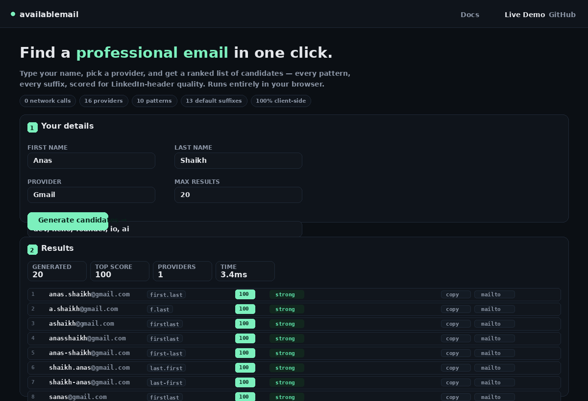
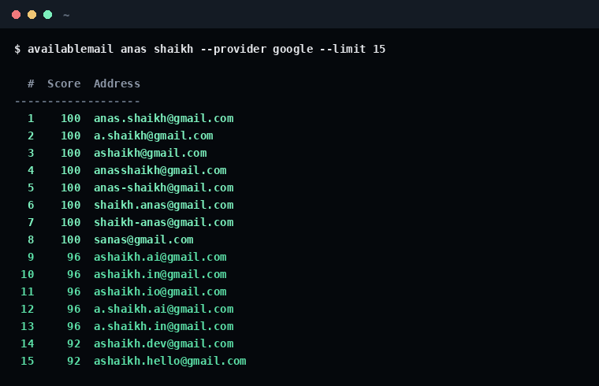
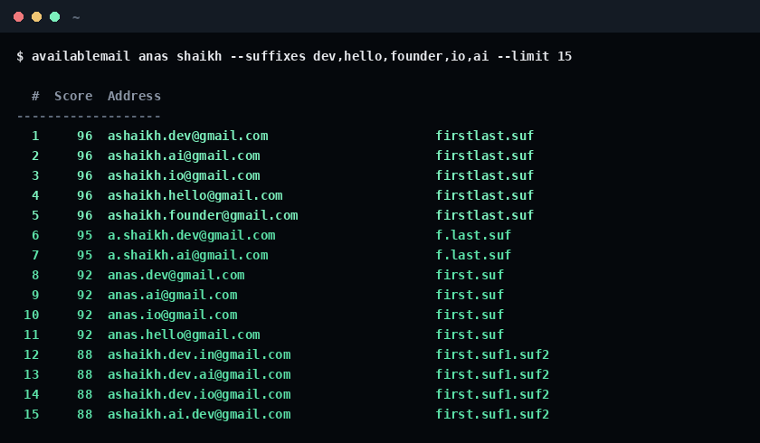
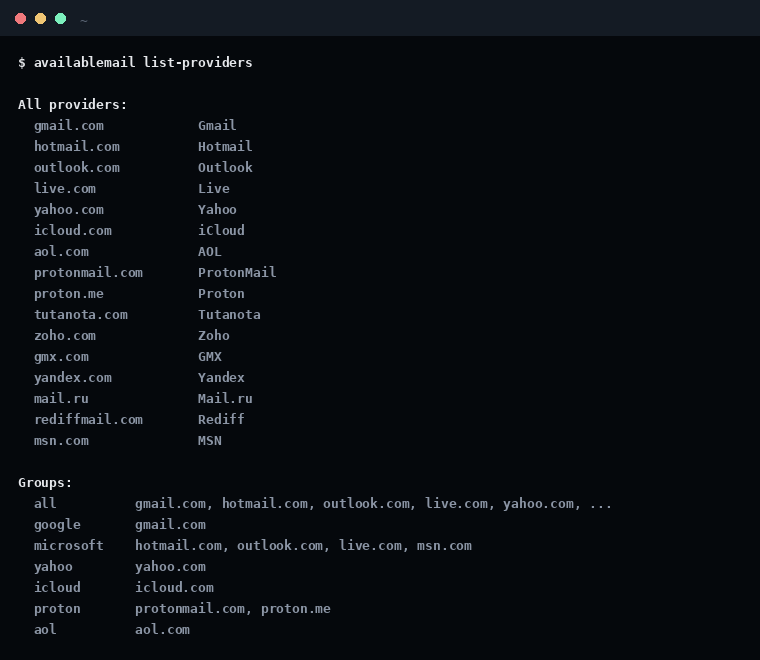

# availablemail

**Find a professional email address from your name and a few keywords.**

[](https://github.com/0xshaikh/availablemail/actions/workflows/ci.yml)
[](https://pypi.org/project/availablemail/)
[](https://www.python.org/)
[](LICENSE)

## 🎬 Live demo — try it right now

[**→ Open the interactive web demo**](https://0xshaikh.github.io/availablemail/demo/)

Type your name, pick a provider, and get a ranked list of candidates — runs
entirely in your browser, zero server, zero install. This is the **same
scoring algorithm** as the Python CLI, ported to client-side JS.

<a href="https://0xshaikh.github.io/availablemail/demo/">
  
</a>

Three ways to use the same tool:

| Surface | URL / command | What you get |
|---|---|---|
| 🌐 **Static demo** | [0xshaikh.github.io/availablemail/demo/](https://0xshaikh.github.io/availablemail/demo/) | Browser UI, client-side JS, zero deps |
| ⌨️ **CLI** | `pip install availablemail && availablemail anas shaikh` | Pipeable, scriptable, JSON/CSV/table |
| 🔌 **Flask API** | `bash webapp/run.sh` → `POST http://localhost:5000/api/search` | Real Python backend, deploy anywhere |

Deploy the Flask backend to Render.com / Fly.io / PythonAnywhere — see
[`deploy/PUBLISH.md`](deploy/PUBLISH.md).

## Screenshots

<details>
<summary><strong>1. The live web demo (client-side, works in any browser)</strong></summary>


</details>

<details>
<summary><strong>2. Basic find across Gmail (ranked by professional score)</strong></summary>



</details>

<details>
<summary><strong>3. With custom suffixes (dev, hello, founder, io, ai)</strong></summary>



</details>

<details>
<summary><strong>4. All 16 providers and 7 groups</strong></summary>



</details>

```console
$ availablemail anas shaikh
  #  Score  Address
-------------------
  1    100  a@gmail.com
  2    100  a@aol.com
  ...
```

`availablemail` generates every reasonable pattern (first.last, firstlast,
f.last, flast, ...), appends your keywords (dev, hello, founder, io, codes,
ai, ...), stacks them across every major email provider (Gmail, Outlook,
Hotmail, Live, MSN, Yahoo, iCloud, AOL, Proton, Tutanota, Zoho, GMX,
Yandex, Rediff, Mail.ru), and ranks each candidate by professional quality.

Zero config, zero dependencies, zero network calls by default. Runs in <50ms
for 500 candidates.

## Why this exists

When you register a new account and your real name is already taken, the
signup form silently mints you `yourname12345@gmail.com` — with digits,
because the platform doesn't know what a professional email looks like.

`availablemail` fixes that before you sign up. It hands you a ranked list
of candidates sorted by how they read in a LinkedIn header, an invoice
footer, or a conference badge.

## Install

```bash
# pip (recommended)
pip install availablemail

# or clone + editable install
git clone https://github.com/0xshaikh/availablemail.git
cd availablemail
pip install -e .

# no Python? Use the GitHub Actions cache
uv tool install availablemail
```

No dependencies beyond Python 3.10+. Pure standard library.

## Usage

```console
# Bare minimum — generate candidates for "anas"
$ availablemail anas
  #  Score  Address
-------------------
  1    100  a@aol.com
  ...

# With a last name
$ availablemail anas shaikh --limit 15
  #  Score  Address
-------------------
  1    100  anas.shaikh@gmail.com
  2    100  anas.shaikh@outlook.com
  3    100  anas.shaikh@hotmail.com
  4    100  ashaikh@gmail.com
  5    100  ashaikh@outlook.com
  ...

# Just Gmail
$ availablemail anas shaikh --provider google

# Just Microsoft (Outlook / Hotmail / Live / MSN)
$ availablemail anas shaikh --provider microsoft

# Custom keywords
$ availablemail anas shaikh --suffixes dev,hello,founder,ai,io,codes

# Skip numeric suffixes (cleanest output)
$ availablemail anas shaikh --max-digits 0

# Different providers — no dots in local part (Proton-friendly)
$ availablemail anas shaikh --provider proton

# JSON output for scripting
$ availablemail anas shaikh --format json --limit 20 > candidates.json

# CSV for spreadsheet workflows
$ availablemail anas shaikh --format csv --limit 50 > candidates.csv

# Write to a file (in addition to stdout)
$ availablemail anas shaikh --out my_candidates.txt

# Live availability check for Outlook/Hotmail/Live/MSN (Microsoft's real API)
$ availablemail anas shaikh --provider microsoft --check microsoft
  #  Score  Address
-------------------
  1    100  anas.shaikh@outlook.com      ← AVAILABLE
  2    100  anas.shaikh@hotmail.com
  ...

# List all providers and groups
$ availablemail list-providers
```

## Commands

| Command | Purpose |
|---|---|
| `find [first] [last]` | Generate and rank candidates (default) |
| `list-providers` | Show every supported provider and group |

### Flags for `find`

| Flag | Default | Description |
|---|---|---|
| `--provider` | `all` | Group (`all`, `google`, `microsoft`, `yahoo`, `proton`, `aol`) or single domain (`gmail.com`) |
| `--suffixes` | built-in list of 13 | Comma-separated keywords to try as suffixes |
| `--max-digits` | `3` | Number of numeric seeds to try (0 disables digits) |
| `--limit` | `50` | Max candidates in output |
| `--format` | `table` | `table`, `json`, `csv` |
| `--check` | `heuristic` | `heuristic`, `microsoft`, `smtp` |
| `--out` | — | Also write output to this file |

## Patterns

Generated in this order (most professional first):

1. `first.last` — `anas.shaikh` — the B2B standard
2. `first` — `anas` — clean, casual
3. `firstlast` — `anasshaikh` — compact
4. `first-last` — `anas-shaikh` — legible
5. `f.last` — `a.shaikh` — enterprise-friendly
6. `flast` — `ashaikh` — avoids collisions at scale
7. `lfirst` — `sanas` — last-initial + first
8. `last.first` — `shaikh.anas` — formal (law, finance)
9. `last` — `shaikh` — short, ambiguous
10. `last-first` — `shaikh-anas`

## Providers

| Group | Domains |
|---|---|
| `google` | `gmail.com` |
| `microsoft` | `hotmail.com`, `outlook.com`, `live.com`, `msn.com` |
| `yahoo` | `yahoo.com` |
| `proton` | `protonmail.com`, `proton.me` |
| `aol` | `aol.com` |
| `icloud` | `icloud.com` |
| `others` | `gmx.com`, `yandex.com`, `zoho.com`, `tutanota.com`, `rediff.com`, `mail.ru` |
| `all` | everything above |

## Availability checking

Email availability is a hard problem. Here's the honest truth:

- **Gmail, Yahoo, iCloud, AOL, Proton, Tutanota, Zoho, GMX** are *catch-all*
  for RCPT TO probes — they accept any address and bounce later. There is
  no public API that tells you if a username is taken *before* signup.
  The only way to know is to attempt signup.

- **Outlook, Hotmail, Live, MSN** have a real, semi-public signup
  availability endpoint at Microsoft's account API. `availablemail`
  can call it directly. Set `--check microsoft` and it will show which
  candidates are truly free on those domains.

- **Corporate / custom domains** — SMTP RCPT TO + catch-all detection
  works. This tool defaults to the DNS-level `--check smtp` mode which
  will only confirm that the MX resolves; you'll need a paid verifier
  (ZeroBounce, NeverBounce, Clearout, MailboxLayer) for real corporate
  availability checks.

For a professional email address, you usually want to try 5–10 candidates
anyway. `availablemail` gives you that ranked list in <100ms.

## Score breakdown

Each candidate gets a 0–100 professional score:

| Factor | Effect |
|---|---|
| Very short local part (< 6 chars) | + |
| Long local part (> 16 chars) | − |
| Digits appended | −15 per digit group |
| Suffixes stacked (dev.hello.founder) | −8 per suffix |
| Bare name (no dots, e.g. `anas`) | −5 |
| Dot in local part on Proton | −60 (Proton free doesn't allow it) |

Higher is more professional. The list is sorted best-first.

## FAQ

**Does this actually check if an address is available?**

Only for Microsoft (Outlook/Hotmail/Live/MSN). Everywhere else, this tool
is a ranker, not an availability oracle. The provider will tell you for
sure when you try to sign up.

**Can I use it offline?**

Yes. Heuristic mode uses zero network calls. `--check heuristic` is the
default.

**Will Google block me for probing?**

No — this tool does not probe Gmail. It just generates local parts you
could try. Only `--check microsoft` makes network calls, and only to
Microsoft.

**How is this different from "just check on signup"?**

You try, it's taken, you try another, that's taken. With `availablemail`
you get a ranked list of ~20 options up front, in a form you can paste
into a signup form one by one. The scoring reflects how the address reads
in the wild, not just whether it might work.

**Can I add my own patterns or suffixes?**

Yes — pass `--suffixes dev,mykeyword,mycompany` on the CLI. The generator
is a single 300-line file; the pattern list is a plain Python list you
can extend.

## Web app

Two ways to serve a live web demo from this repo:

### 1. Static demo (default, on GitHub Pages)

`docs/demo/index.html` is a **pure client-side JS port** of the Python
generator. Same patterns, same scoring, same filters — just runs in the
visitor's browser. No server cost, no API keys, works offline once loaded.

Push to `main` → GitHub Pages auto-deploys to
<https://0xshaikh.github.io/availablemail/demo/>.

### 2. Flask backend (deploy the real Python code)

`webapp/app.py` is a Flask app that calls the actual `availablemail`
package. Exposes:

| Endpoint | Method | Description |
|---|---|---|
| `/` | GET | Serves the demo HTML |
| `/health` | GET | Health check |
| `/api/patterns` | GET | Lists providers, groups, pattern templates |
| `/api/providers` | GET | Providers + groups only |
| `/api/search` | POST | JSON in → ranked candidates out |

Example request:

```bash
curl -X POST http://localhost:5000/api/search \
  -H 'Content-Type: application/json' \
  -d '{"first_name":"Anas","last_name":"Shaikh","provider":"gmail","limit":10}'
```

Run locally:

```bash
bash webapp/run.sh   # creates venv, installs deps, starts Flask on :5000
```

Deploy to Render.com / Fly.io / PythonAnywhere — see
[`deploy/PUBLISH.md`](deploy/PUBLISH.md). Configs are checked in:

- `deploy/render.yaml` — Render Blueprint
- `deploy/fly.toml` — Fly.io config
- `deploy/local.sh` — one-shot local launch with optional Cloudflare tunnel

## Architecture

```
availablemail/
├── availablemail/
│   ├── generator.py    # candidates, patterns, scoring
│   ├── checker.py      # heuristic / microsoft / smtp modes
│   └── cli.py          # argparse entry point
├── docs/
│   └── demo/           # static client-side web demo (GitHub Pages)
├── webapp/             # Flask API backend (deploy anywhere)
│   ├── app.py
│   ├── requirements.txt
│   └── run.sh
├── deploy/             # deploy configs + PUBLISH.md
│   ├── render.yaml     # Render.com Blueprint
│   ├── fly.toml        # Fly.io config
│   ├── local.sh        # one-shot local launch
│   └── PUBLISH.md      # step-by-step deploy guide
├── tools/              # dev utilities (screenshot generator, tests)
├── assets/             # screenshots
├── tests/              # 49 pytest cases
└── pyproject.toml
```

Zero runtime dependencies. Only dev deps: `pytest`, `pytest-cov`, `ruff`.
The Flask app adds `flask` + `gunicorn` at deploy time (see
`webapp/requirements.txt`).

## How the scoring works

Every candidate starts at **100**. Then penalties and bonuses apply:

| Rule | Effect |
|---|---|
| Local part ≤ 12 chars | no penalty |
| 13–16 chars | `-4` |
| 17–20 chars | `-10` |
| > 20 chars | `-20` |
| Every trailing digit | `-15` |
| Every suffix | `-8` |
| Pattern = `first.last` | `+6` (B2B standard) |
| Pattern = `f.last` | `+4` |
| Pattern = `first.last`-family | `+2` |
| Pattern = `first` or `last` | `-5` |
| Proton + dot in local part | `-60` (Proton rejects dots) |

Score is clamped to `[0, 100]`. Higher = more professional.

The **exact same scoring** runs in the Python CLI and the client-side
web demo — you can diff any candidate's score across all three surfaces.

## Contributing

See [CONTRIBUTING.md](CONTRIBUTING.md). Issues welcome, bugs
especially.

The web demo (`docs/demo/index.html`) is a faithful port of
`availablemail/generator.py` — if you change the Python scoring,
update the JS to match. The Flask app (`webapp/app.py`) is a thin
wrapper and needs no special care.

## License

[MIT](LICENSE). Free for commercial and personal use.

---

Made with 🧡 by [0xshaikh](https://github.com/0xshaikh).
